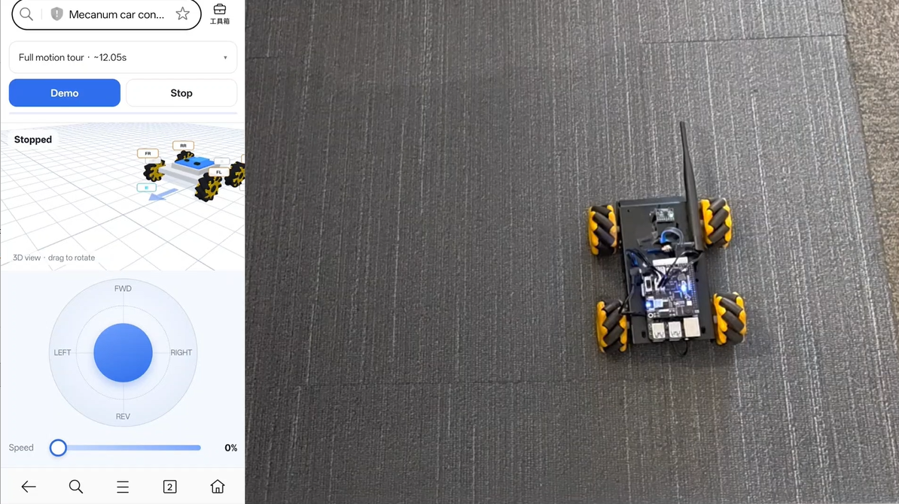

# 🚗 麦轮小车运动控制 Demo - Mecanum Wheel Car Motion Control

[English](README.md) | 中文

本项目基于 [Quectel Pi M2 智能主控板](https://www.quectel.com.cn/product/quectel-pi-m2) 开发。
M2 经 40pin 直插连接幻尔（Hiwonder）树莓派5扩展板（A 款 / RasAdapter5A），用 1 Mbps UART 下发逐轮占空；
扩展板自带的 STM32 固件驱动四路电机，麦轮底盘由此实现任意方向、斜行、边走边转与漂移。
手机或电脑浏览器直接打开 `http://<板子IP>:8080/` 即可操作，无需安装客户端；
MPU6050 用于闭环转角与直行航向保持。



▶ **[观看演示视频](assets/demo-car-motion-control.mp4)**（约 51 秒）

## 🎯 功能特点

- **任意方向，不止八方向**：逐轮占空下发，摇杆给多少角度就走多少角度，不再 45° 吸附
- **麦轮全动作**：斜行、边走边转、漂移（后两轮反向加力）、单轮点检都能做
- **IMU 闭环转角**：MPU6050（`/dev/i2c-3`）PD + 低速精调，正方形归位不累积转角误差；直行用航向保持纠偏
- **无硬件也能跑**：`--sim` 仿真板复刻真机行为（解析电机帧、每 200ms 推电池帧、坏 CRC 丢包）
- **亮 / 深两套皮肤一份 markup**：`/` 亮色、`/dark` 深色；手机访问 `/` 自动进精简版 `/m.html`
- **浏览器即控制端**：3D 车模、摇杆、状态全部由板端服务提供，演示跑在服务端，刷新或息屏都不打断
- **安全兜底**：急停立即四轮 0 占空；8 秒无请求自动归零；SIGINT/SIGTERM 先停车再退出
- **不烧录、不改板端**：只用扩展板自带固件，工程只做上位机；协议用官方 CRC8 表并带真机抓包回归
- **依赖只有一层**：运行期只需 `pyserial`（缺失时自动回退内置 termios 实现），Web 服务用标准库

## 📋 系统要求

### 硬件要求

- Quectel Pi M2 智能主控板（Debian 13 出厂镜像，40pin 扩展口）
- 幻尔树莓派5扩展板 A 款（RasAdapter5A，板载 STM32 固件，**无需烧录**）
- 麦轮底盘 + 4 路 TT 类电机（接线 FL→M1 / FR→M2 / RR→M4 / RL→M3）
- 电池（实测 7.6~7.9 V；扩展板经 40pin 给 M2 供电）
- MPU6050 陀螺仪（板载，`/dev/i2c-3`，可选：没有时转角退回定时开环）
- 手机 / 电脑（与板子同一网络，浏览器打开控制页面）
- HDMI 显示器 + USB 键鼠（可选，用于板端本地操作与排障）
- 远程调试时用 SSH 终端（可选）：`ssh <用户名>@<板子 IP>`，板上目录为 `~/projects/demo-car-motion-control`

扩展板 40pin 直接对插 M2，**不需要额外接线**（串口 / 地 / 电源都走 40pin）：

| M2 40pin | 引脚定义 | 作用 |
| --- | --- | --- |
| **8** | `GPIO2_B0_d`（UART1_TXD） | M2 → 扩展板（`/dev/ttyS1`） |
| **10** | `GPIO2_B1_d`（UART1_RXD） | 扩展板 → M2（板子 5Hz 推电池帧） |
| **9** | `GND` | 共地 |
| 2 / 4 | `5V` | 电池经板子给 M2 供电（实测可读 7.90 V） |

### 软件要求

- 操作系统：Debian 13（Quectel Pi M2 出厂默认系统镜像，无需重新烧录）
- Python：Python 3（板上用 `python3 -m venv` 创建隔离环境）
- 依赖组件：`pyserial`（唯一第三方依赖，见 `requirements.txt`；缺失时用内置 termios 实现）
- 串口节点：`/dev/ttyS1`，**1 Mbps 8N1**，无流控；读串口需 `dialout` 组权限
- 外设节点：`/dev/i2c-3`（MPU6050，可选）
- 网络端口：`8080/tcp`（Web 页面与 JSON API）

## 🚀 安装与运行

1. 在智能主控板上打开终端，使用 git 克隆项目代码。

```bash
sudo apt update && sudo apt install -y git
git clone https://github.com/weltonjiang/demo-car-motion-control.git
```

执行完成后，当前目录下应生成 `demo-car-motion-control` 文件夹。

2. 进入项目目录，执行部署脚本（幂等，重复执行只补缺失部分）。

```bash
cd demo-car-motion-control
./install.sh            # 没有可执行位时：bash install.sh
```

脚本会创建 `.venv`、安装依赖、体检系统缺哪些包，并装上 `~/carurl` 快捷命令。
手动等价方式：

```bash
python3 -m venv .venv && .venv/bin/pip install -r requirements.txt
```

3. 装完先做**只读自检**（车不会动，建议架起车、手边留电源开关）。

```bash
python3 test_tools/serial_probe.py --scan   # 哪条 tty 在应答
python3 test_tools/serial_probe.py          # 读到电池帧 7.90 V 即接线 / 1 Mbps / CRC 都对
```

4. 运行程序。

```bash
./run.sh --sim              # 没接扩展板时先看界面（仿真）
./run.sh                    # 自动探测串口（找不到则退回仿真）
./run.sh --port 8080        # 指定 Web 端口
```

启动时会枚举本机所有非回环 IPv4 并逐个打印可访问地址（IP 每次开机 / Wi-Fi 重连可能变，以打印为准）：

```text
  访问地址 : http://192.168.4.1:8080/    (wlan0)
             http://192.168.1.50:8080/   (eth0)
  深色主题 : http://192.168.4.1:8080/dark
```

忘了 IP 时：`~/carurl`、`cat ~/.wheel_urls`，或 `journalctl -u demo-car-motion-control -b | grep -A7 主机名`。

### 配置开机自启动（可选）

```bash
sed -i "s|^User=.*|User=$USER|; s|<user>|$USER|g" scripts/demo-car-motion-control.service
sudo cp scripts/demo-car-motion-control.service /etc/systemd/system/
sudo systemctl daemon-reload
sudo systemctl enable --now demo-car-motion-control
```

单元里的 `User=` 与路径 `<user>` 都要替换成本机用户名；模板用**绝对路径**而不写 `%h`，
避免启动早期被解析成 `/root`。

让主控板自己发 Wi-Fi 热点（现场没路由器时）：

```bash
sudo SSID=QuectelPi PASS=<至少8位密码> ./scripts/setup_wifi_ap.sh
```

之后页面地址固定为 `http://192.168.4.1:8080/`。

## 🎛️ 使用说明

页面顶部是演示选择与进度条，左列是摇杆、单轮点检与扩展板反馈，右列是 3D 车模与事件日志；
手机访问自动换成精简版（状态胶囊 + 大摇杆 + 3D）。

- 摇杆拖拽即动，**任意角度**，拖得越远速度越大（上限 `control.max_velocity`，默认 80%）
- 键盘 `W/A/S/D` 或方向键（可斜行），`Q/E` 叠加左 / 右自转，`空格` / `Esc` 停车
- 两个滑块分别是平移速度与自转速度；**漂移开关**对应 `drift=1`（后两轮反向加力）
- 单轮点检四个滑块直接写 M1~M4 的占空，用于校验接线 / 轮序 / 转向
- 演示 9 套：`tour` 综合巡演 / `star` 米字 / `spin` 旋转阶梯 / `diag` 四向斜行 / `dir_scan` 八方向点检 /
  `drift` 漂移 / `wheel_scan` 单轮点检 / `home_imu` 正方形归位（IMU 闭环）/ `dist_check` 量距标定；
  `spin`、`diag` 默认隐藏（`demo.hidden`）
- 扩展板反馈面板默认收起，展开后给电池电压（SYS 上报）、上报延迟、收到帧数与链路状态
- 手机访问 `/` 自动进精简版；`/m.html` 精简、`/index.html` 完整、`/dark` 深色完整
- 演示在**服务端**执行，页面刷新或手机息屏都不会打断

### 协议要点

```text
帧 : 0xAA 0x55 | func | len | data | crc8（覆盖 func+len+data）
电机: func=3, data=[0x05(占空), 个数] + 每电机 5B（<Bf: 索引=编号-1, -100~100）
电池: func=0, data=[0x04, mv_lo, mv_hi]   ← 板子每 ~200ms 主动推
```

- 波特率 **1 Mbps** 8N1，不是 9600/115200（低波特率只会收到乱码）；
- CRC8 必须用官方 `crc8_table` 查表，**不要倒推多项式**（本工程原样抄表，并用真机抓包回归）；
- 板子主动上报，指令帧不需要应答 → 用 SYS 帧当心跳（2 秒收不到标链路异常）；
- 占空 `-100~100` 主机侧硬钳位；开环占空有启动死区，主机侧按轮做**死区补偿**
  （`board.deadzone_pct` 默认 15%：0 保持 0，非 0 从死区起步线性映射到 100）。

### 轮序与方向标定

| 位置 | 电机接口 | 车体序 |
| --- | --- | --- |
| 左前 FL | **M1** | 1 |
| 右前 FR | **M2** | 2 |
| 右后 RR | **M4** | 3 |
| 左后 RL | **M3** | 4 |

这是幻尔官方标准接法（M1/M2 = 前轴，M3/M4 = 后轴），按此接线后用单轮点检逐轮验证。
`config.json` 里四层各管一件事，不要混：

```jsonc
"board":   { "motor_order":  [1, 2, 4, 3],              // 车体序 FL/FR/RR/RL → M1/M2/M4/M3
             "motor_invert": [false, true, false, true] }, // 按车体序：左侧(-) 右侧(+)
"control": { "invert_motors": true,                      // 四轮整体反接
             "invert_angle":  true,                      // 左右镜像补偿：角度需镜像
             "invert_rot":    true }                     // 左右镜像补偿：自转方向需取反
```

> `motor_order` 必须和接线一致，`invert_*` 才是纠正方向的手段，不要反接电机线。

换车 / 换线后的重标顺序：

1. `前进`：只看车是否朝车头走（四轮同向，对左右互换不敏感）；
2. `左平移` + `原地左转`：两者同时反 ⇒ 设 `invert_angle` + `invert_rot`；只反一个 ⇒ 只设对应的那个；
3. 逐轮点动（`/api/raw` 每次只给一个轮 +30%）：轮顶朝车头为正，反了就翻 `motor_invert` 对应位；
4. 全部通过后，**前进 / 左平移 / 原地左转** 三项应自动都对。

`home_imu` 正方形归位的现场标定：直行段跑一次量出实际边长，按 `实测/目标` 调 `demo.home.scale`
（实测 330mm 想走 300mm → `scale ≈ 0.91`）；换车或换地面前先跑 `dist_check` 重新量距，
再按实测值调 `board.max_speed_mm_s`。

## 📁 项目结构

```text
demo-car-motion-control/
├── run.sh                 启动脚本（自动选解释器 / 探测串口）
├── install.sh             板端部署（建 .venv、装依赖、装 ~/carurl 快捷命令）
├── config.json            串口（1 Mbps）/ 死区补偿 / 限速 / 心跳 / IMU / Web 端口
├── requirements.txt       依赖清单（只有 pyserial）
├── README.md              英文说明
├── README_zh.md           中文说明（本文件）
├── assets/                配图、演示视频与界面截图
├── docs/
│   └── 使用手册.md         接线、Wi-Fi、页面操作、演示、标定、安全、排障
├── scripts/
│   ├── show_access_url.sh 打印可用的访问地址
│   ├── preflight.sh       实地跑之前的只读检查清单（供电 / 串口 / 链路 / 网络 / 服务）
│   ├── setup_wifi_ap.sh   把 M2 配成 Wi-Fi 热点
│   └── demo-car-motion-control.service  systemd 自启单元
├── src/
│   ├── main.py            入口：参数解析 + 启动服务
│   └── wheelctl/
│       ├── protocol.py    0xAA55 协议：官方 CRC8 表、组帧 / 解帧、死区补偿
│       ├── kinematics.py  麦克纳姆轮分解（纯几何）
│       ├── transport.py   串口（1 Mbps）+ 仿真扩展板
│       ├── imu.py         MPU6050：零偏校准、闭环转角、直行航向保持
│       ├── driver.py      逐轮占空指令流、心跳、急停、状态汇总
│       ├── demo.py        演示序列（9 套）
│       ├── netinfo.py     枚举本机 IPv4，算「该用什么网址访问」
│       ├── config.py      配置加载（含环境变量覆盖）
│       └── server.py      HTTP 服务与 JSON API
├── test_tools/            测试与诊断（协议 28 项、运动学 16 项、仿真自检 106 项）
└── web/                   前端：index.html / mobile.html / app.js / car3d.js / style*.css
```

## 📚 更多文档

接线与供电细节、Wi-Fi 组网、页面逐项操作、演示动作说明、IMU 闭环转角参数、安全设计与故障排查，
见 [docs/使用手册.md](docs/使用手册.md)；第三方组件许可见 [THIRD_PARTY_LICENSES.md](THIRD_PARTY_LICENSES.md)。

三套自检都**不需要硬件**：

```bash
python3 test_tools/test_protocol.py     # 协议单测 28 项
python3 test_tools/test_kinematics.py   # 运动学单测 16 项
python3 test_tools/selfcheck_sim.py     # 端到端仿真自检 106 项
```

## 📮 报告问题

如在使用过程中遇到问题，欢迎在 [Quectel Pi 开发专区](https://forumschinese.quectel.com/c/quectel-pi/58)
提交技术咨询，我们的技术支持团队将及时为您解答。

欢迎提交 Issue 和 Pull Request 来改进此项目。
